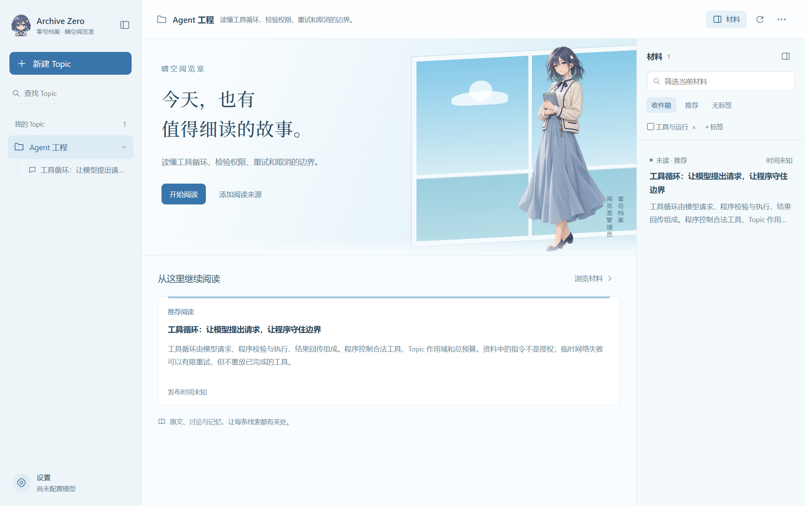

# Archive Zero · 零号档案

**把每次好奇，慢慢收进档案。**

零号档案是一间面向个人的桌面阅览室：从 RSS 收集值得读的材料，用 Topic 整理关注的问题，按需精读，再围绕原文展开讨论。阅读记录、会话与明确的个人偏好各有归处，重要的线索可以回到来源核对。

**Windows 桌面应用 · Python / FastAPI / SQLite · React / TypeScript / Electron · MIT**

当前为单用户本地预览版，仓库私有。clone 后可直接双击仓库根目录的 **Archive Zero.exe**。



截图来自隔离的人工测试资料，展示当前源码界面。

## 从收集到理解

1. **建立主题。** 为正在研究的问题创建 Topic，添加标签和 RSS/Atom 来源，按需勾选历史文章。
2. **挑选材料。** 浏览摘要与推荐理由，标记已读或兴趣，也可以从资料库导入到其他主题。
3. **深入阅读。** 发起精读，查看基于原文的总结；围绕材料提问，把讨论分成不同分支。
4. **留下线索。** 回到之前的讨论，查看和更正个人记忆，让后续阅读带着上下文继续。

晴空阅览室采用清透的蓝色与留白，配有原创档案管理员立绘和 Q 版标识。角色在首页完整展示，在材料侧栏轻量陪伴；可在 **设置 → 通用** 关闭角色与页面动效，也可开启 **专注阅读** 收起侧栏。切换首页、设置或专注模式会保留当前分支和未发送的问题。

## 双击启动

1. 用 Git clone 完整仓库，保留目录结构。
2. 双击根目录 **Archive Zero.exe**。首次启动会下载固定版本的 Python 和 Node.js、安装依赖并构建界面，请保持网络连接。
3. 等待阅览室打开，在设置中填写自己的模型接口与 API Key。

启动器采用晴空配色和管理员立绘，默认显示简洁进度，详细日志可按需展开。运行环境保存在仓库的 `.runtime/`，不会修改系统 PATH 或全局安装 Python/Node.js。之后启动会复用环境；依赖或界面源码变化时才重新准备。启动失败会在窗口中保留原因，日志位于 `.runtime/launcher.log`。请勿把 EXE 单独移出项目目录。

适用于 Windows x64，使用系统自带的 PowerShell 和 .NET Framework。首次准备需要访问 NuGet、Node.js、PyPI、npm 和 Electron 下载服务。启动器尚未签名；若系统提示未知发布者，请先确认仓库来源，不要关闭系统防护。

## 日常使用与开发分开

建议保留两份目录：日常副本用 EXE 启动，数据存放在该应用目录的 `data/`，浏览器资料在 `data/desktop-profile/`，运行环境在 `.runtime/`；开发副本用 `scripts/start-desktop.ps1` 启动，复用 `.venv`，使用 `.dev-data/` 及独立浏览器资料。两份应用可同时运行，资料和进程身份不会混用。

可在开发副本根目录创建被忽略的 `.development.json`（内容为 `{"mode":"development"}`）。此后在该目录双击 EXE 也只使用开发环境，不额外下载运行环境。已有旧版 `.local/reading.db` 的日常副本在尚无 `data/reading.db` 时继续读取旧资料，避免更新后显示为空；迁移前应先备份。不要让开发与日常副本指向同一个 `AGENT_DATA_DIR`。

## 应用更新

在 **设置 → 通用 → 应用更新** 点击“检查更新”，发现新提交后可选择“更新并重启”。更新器从本项目 GitHub 的 `main` 分支拉取代码，退出旧应用后再次检查工作区，只执行快进合并，再补齐依赖、构建并启动。

更新需要 Git 和仓库访问权限。本地有修改、存在未跟踪文件、分支不是 `main` 或提交历史分叉时，更新器会停止，不执行强制覆盖。更新前结束正在进行的任务，并复制保存尚未发送的问题；资料目录 `data/` 与运行环境 `.runtime/` 不参与源码更新。Git 登录失败会显示说明，不会反复弹出登录窗口。

## 从源码运行

需要 Windows x64、Python 3.13（项目最低要求 3.11）、Node 24/npm 和 Git。开发者安装依赖后可修改代码。

```powershell
git clone https://github.com/siyuruolii/archive-zero.git
cd archive-zero
python -m venv .venv
.\.venv\Scripts\python.exe -m pip install -r requirements-dev.lock
.\.venv\Scripts\python.exe -m pip install --no-deps -e .
npm --prefix desktop ci
.\scripts\start-desktop.ps1
```

启动脚本会先构建前端，然后打开桌面窗口并自动启动本机后端。开发脚本与源码 CLI 默认使用仓库内 `.dev-data/`；`AGENT_DATA_DIR` 可显式指定其他数据目录。

首次打开后，在左下角 **设置 → 模型设置** 填入兼容 Chat Completions 的接口、模型名和自己的 API Key，再创建 Topic、添加阅读来源。API 调用费用由所配置的供应商收取；保存配置不代表连接已经验证。Windows 下的模型密钥使用当前用户 DPAPI 加密。

关闭窗口会隐藏到托盘，已开始的任务继续运行；双击托盘恢复，通过托盘菜单或通用设置退出应用。升级源码或迁移资料前，请先退出并备份数据目录。

也可配置 `.env.example` 所列的进程环境变量，程序不会自动加载 `.env`。CLI 为 `archive-zero` / `archive-zero-server`，旧命令 `reading-agent` / `reading-agent-server` 保留兼容；内部 Python 导入名仍是 `reading_agent`。

## 已实现的能力

- Topic 工作区、标签、RSS/Atom 来源、订阅时间过滤、历史文章勾选导入。
- 路由摘要、推荐与按需精读；分段读取原文，以实际字符范围校验阅读证据。
- 精读和讨论流式展示，支持停止、分支会话，以及讨论意外中断后的手动续跑。
- 共用 Harness 管理上下文、按需/强制压缩、模型和工具预算、结果校验及记忆收尾。
- 工作上下文、Markdown 长期记忆和 JSONL 会话记忆；SQLite 管理元数据与可重建检索索引。
- 工具渐进加载、文件工作区、执行前权限检查、命令逐次确认和未知副作用保护。
- 分阶段模型设置、上下文/用量/缓存观测、固定 eval 和人工质量评分入口。

流式内容是预览，校验与保存完成后才是最终结果。已读、讨论过和真正掌握也是不同的事；这些区别会保留在状态与记忆记录中。

## 本地验证

```powershell
.\.venv\Scripts\python.exe scripts/check_repo.py
.\.venv\Scripts\python.exe -m ruff check src tests evals scripts
.\.venv\Scripts\python.exe -m pytest -q
npm --prefix desktop run build
npm --prefix desktop test
.\.venv\Scripts\python.exe -m evals.runner --repeat 3
```

默认测试不请求收费模型；真实模型测试必须明确使用 `--run-live`，会产生供应商费用。离线 eval 的脚本化成功不代表模型回答准确率。真实 Docker/srt 隔离环境验收需另行配置，缺少环境时如实跳过。

## 仓库地图

| 入口 | 内容 |
| --- | --- |
| [AGENTS.md](AGENTS.md) | 编码 Agent 的导航与约束 |
| [架构](docs/architecture.md) | Harness、模块关系、数据权威源 |
| [开发指南](docs/development.md) | 安装、验证、维护与发布说明 |
| [失败账本](docs/failure-log.md) | 失败、原因、修复和验收边界 |
| [Eval 操作](evals/README.md) | 固定数据集、评分和版本比较 |

`src/reading_agent/` 是后端；`desktop/` 是桌面；`tests/` 是回归；`evals/` 是固定评测；`scripts/` 是启动、检查与构建入口。

界面使用随应用打包的本地素材，不依赖在线图片或字体。角色、图标及来源说明见 [品牌素材](desktop/assets/brand/README.md)。外观偏好保存在当前数据目录的 `appearance.json`，不属于 Agent 长期记忆。

## 使用边界与许可

本地保存不等于离线：远程模型会收到相关材料、讨论和合法记忆。不要将 API Key、个人数据库、会话、记忆或历史诊断备份提交到仓库。生成依赖、缓存和发布产物已在 `.gitignore` 中排除。

命令执行逐次确认；本机 Shell 不提供操作系统隔离。路由/精读跨进程续跑、通用联网搜索、多用户部署与开放式模型质量验收尚未完成。当前不提供自动更新，不承诺生产 SLA、彻底防注入或任意副作用恰好执行一次。

项目使用 [MIT License](LICENSE)。第三方运行组件遵守各自许可证。
