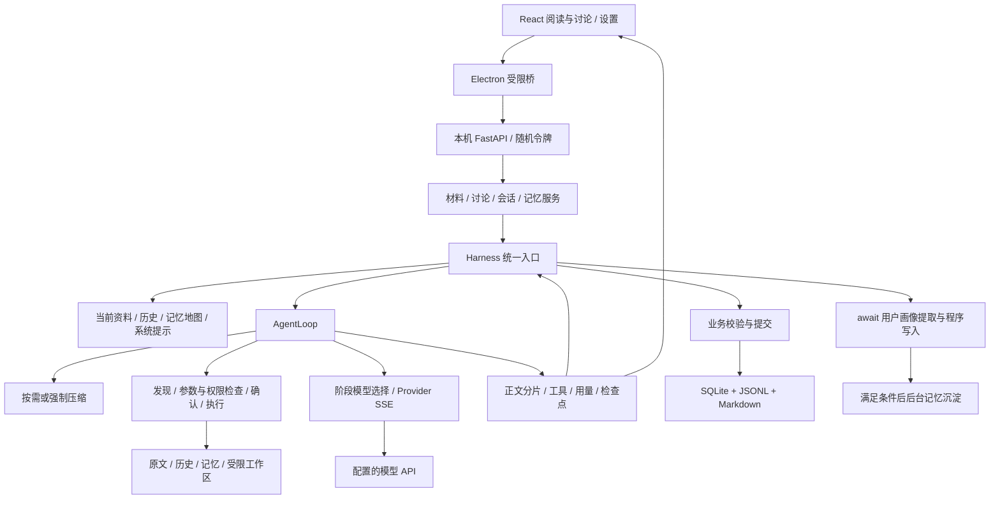

# Archive Zero 当前架构

核对日期：2026-11-09。本文描述当前代码；设计历史与失败见 [失败账本](failure-log.md)，验证命令见 [开发指南](development.md)。

## 调用链与职责

这是一个本机后端中的模块关系图，不是分布式微服务。路由、精读、讨论、沉淀共用 Loop，以角色规则、结果模型和工具范围区分；不是多 Agent 协作平台。

| 路径（src/reading_agent/ 下） | 主要职责 |
| --- | --- |
| interfaces/api.py、server.py | 应用组合入口、生命周期、后台轮询与鉴权接线 |
| interfaces/routes/ | materials / sessions / memory 业务路由；common 放 HTTP 输入和 SSE 适配 |
| domain/models.py | Topic、Tag、Material、HistoricalMaterial 与基础校验类型，不依赖运行时层 |
| services/materials.py | RSS 来源、导入边界、材料与 Topic 视角、路由/精读提交 |
| services/discussion.py、run_stream.py | 讨论调度、停止、草稿/事件快照、手动恢复 |
| services/sessions.py、session_events.py | 会话树、分支、JSONL 事件、SQL 元数据恢复 |
| services/memory/、memory_consolidation.py | service 负责记忆业务编排，documents 负责 MD/目录迁移/索引，recall 负责会话检索与证据回忆，models 放记忆契约；consolidation 负责后台隔离整理 |
| agents/harness.py | 准备上下文 → Loop → 业务提交 → 记忆提取与调度收尾 |
| agents/loop.py、messages.py、recovery.py | 预算/取消/工具往返、消息修复、检查点及保守恢复 |
| agents/context.py、prompts.py、compact.py | 资料装配、结构化系统提示、压缩策略 |
| agents/model_router.py、provider.py、inference.py | 阶段模型配置、HTTP/SSE 适配、无工具辅助推断 |
| agents/tool/、permission.py | 分组工具注册/发现、作用域、路径/权限及执行前保护 |
| agents/streaming.py、telemetry.py | Provider 事件归一化、增量正文、用量/预算指标 |
| storage/database.py | SQLite schema、短事务、外键、唯一约束与基础存储异常 |
| infrastructure/ | 网络获取、锁、配置加密、文件工作区和进程管理 |

业务实体属于 `domain/models.py`；Agent 的 Task、历史消息、最终输出与角色契约仍在 `agents/models.py`。`services/memory/__init__.py` 仅提供公共入口，内部使用 documents / recall 两个职责部件共同实现 Memory 服务，它们依赖服务持有的 store、directory、provider，不作为独立服务实例化。业务继续只通过 Harness 调用模型。

本次按职责拆分，不设机械行数上限：Loop 的预算、取消和工具往返构成一个执行状态机；工具已按能力分组；prompt/context/harness 各有独立职责，暂不新增仅用于包裹单文件的目录。MaterialService 的来源导入与路由/精读仍共享取消和存储状态，后续若继续拆分应先定义显式协作接口，避免增加隐式跨文件状态。

前端在 `desktop/renderer/`，主进程和桥在 `desktop/electron/`；原生端到端测试在 `desktop/tests/`。

桌面采用晴空阅览室主题：`ReadingHome.tsx` 使用当前 Topic 的真实材料与原有操作回调，`sky-theme.css` 负责视觉样式，`AppearanceSettings.tsx` 管理角色与动效开关。首页与专注模式不停止任务、不清空选中分支或问题草稿；材料筛选、精读、讨论、恢复及命令确认仍由原有组件处理。静态角色与图标来自 `desktop/assets/brand/`，不加载外部图片或字体。

外观偏好通过受限 preload/IPC 交给 `electron/appearance.cjs`，校验布尔白名单并原子写入数据目录的 `appearance.json`，不依赖后端随机端口。它仅保存角色/动效偏好，不是 Agent 记忆。专注模式只在本次窗口内收起材料侧栏；系统减少动态效果设置优先。Vite 负责打包页面素材。

日常启动可经根目录 EXE 调用 bootstrap，以仓库内 `.runtime/` 的 Python/Node 运行应用。应用更新通过受限 IPC 在独立进程检查 GitHub main，用户确认后退出应用，由启动器副本执行经过保护的快进更新，再重新检查依赖与前端构建指纹。业务数据目录不参与更新，源码更新失败不回退或覆盖本地用户修改。日常使用 `data/` 与独立 profile；开发使用 `.dev-data/`、`.venv`，不读取日常模型设置。开发标记 `.development.json` 也让 EXE 走开发路径，窗口采用 WPF/XAML，日志按需展开。

## 一轮任务

1. 业务构造 Task 与 Corpus，经 Harness 统一入口。讨论从当前分支取得历史，绑定原用户问题和合法记忆。
2. 系统提示按固定规则、角色、运行快照、能力、生命周期、记忆地图、工具指南和输出契约装配。材料和工具返回始终是事实资料，不是授权。
3. 每次模型请求前修复消息配对并按需压缩（force=false）；供应商明确报上下文过长时强制压缩（force=true），仍计入预算。
4. 模型请求工具，程序检查角色/参数/作用域/权限/路径/版本与确认，再执行。返回工具事实，模型继续决策。
5. Provider 分片转为事件，Loop/Harness 异步向外 yield，桌面通过 SSE 显示正文预览、进度和指标。有界队列溢出时依赖运行快照恢复界面状态，不能当作最终结果。
6. 最终 JSON 经 Pydantic 和业务约束校验，由服务提交。讨论提交成功后 await 用户画像候选提取与程序落盘，再按条件调度后台沉淀。提取失败独立记录，不回滚已保存回答。

## 记忆和数据权威源

| 数据 | 权威来源 | 派生或约束 |
| --- | --- | --- |
| Topic、来源、材料、反馈 | SQLite | 模型不能直接写业务表 |
| 会话事件和内容 | sessions/*.jsonl | SQLite 管理树结构、位置、运行元数据和可重建检索索引；读正文须 hydrate |
| 长期记忆 | memories/ 中 MD | 画像、用户阅读动作、Agent 阅读记录；阅读类 memory.md 只放索引链接，entries/ 存 frontmatter 与正文 |
| 当前工作记忆 | PreparedContext/Loop 消息 | 每轮预算、压缩和任务作用域约束 |
| 模型配置与凭据 | 本机配置 / 进程环境 | Windows DPAPI；不写入业务表、日志或测试夹具 |

用户“标为已读”和 Agent 实际读取是不同事实，讨论不等于掌握。Agent 阅读记录带正文哈希、范围和时间；旧内容不得冒充当前原文。会话检索使用 FTS5 的 unicode61/trigram 召回，展开来源后由模型针对问题归纳，不是向量数据库或全局万能语义搜索。

MD 写入使用 `.memory.lock` 和原子替换，SQL 索引可重建。沉淀 Agent 只修改隔离副本，发布时检查版本与冲突，并保存持久水位；不是每轮运行一次。默认阈值见 ConsolidationPolicy（20 条新增、冷却 1800 秒、间隔 86400 秒），实际可配置。

## 工具、安全与失败恢复

工具按 material/memory/session/filesystem/shell/discovery 分组，registry 集中注册。`search_tool` 渐进加载 schema；发现不等于授权。执行器在缓存返回和实际执行前检查当前权限，敏感路径拒绝优先于配置和等级。

文件在任务工作区内访问，写入/编辑使用版本检查。Bash 每次用户确认；优先选择可用 Docker/srt，否则明确确认本机后端。选定更弱后端必须展示真实权限，不沿用旧审批。本机动态命令无法靠字符串规则实现 OS 隔离。

只有明确只读且声明可重试错误的工具自动有限退避，每次尝试消耗预算。永久错误交还模型；写入/命令不自动重试。未知副作用阻止后续写入/命令，不保证外部副作用恰好一次。

讨论检查点保存消息、预算、用量、已加载工具及读取凭据；工具意图/结果独立追加，恢复同时读取检查点后的事件。重启只标 interrupted，由用户手动续跑。恢复校验分支、任务、权限和材料/文件版本，继承预算，不恢复旧授权。已写文件先核对目标状态，不盲目重写；命令执行未知不重放。心跳耗时是保守近似，停机时间排除。

## 观测和评估

报告包含模型轮次、工具、结束原因、用量、压缩、缓存与恢复信息。窗口面板区分供应商 token 和 UTF-8 字节保守代理，未报告指标保持未知。稳定前缀与分阶段模型支持成本控制，但渐进工具加载/压缩可能破坏前缀，不能保证缓存命中率。

固定 eval 为 40 案例，分离硬约束与人工质量评分。离线脚本化运行验证执行和评分链路，真实模型质量待独立评审；不把通过 JSON/覆盖范围校验当作忠实性的充分条件。

## 关键不变量与当前缺口

服务通过 Harness 调 Agent，Agent 不依赖具体服务/HTTP 层；SQLite 事务内不等待网络。结果保存、记忆提取和事件预览有各自状态。会话内容不能只从 SQL 元数据恢复，日志不可当缓存删除。

当前无生产部署、多用户权限体系、通用联网搜索工具或多 Agent 编排。已有 RSS/静态网页获取；不执行网页脚本。路由/精读跨进程恢复、真实 Docker/srt 验收和开放式质量基准仍是明确缺口。
